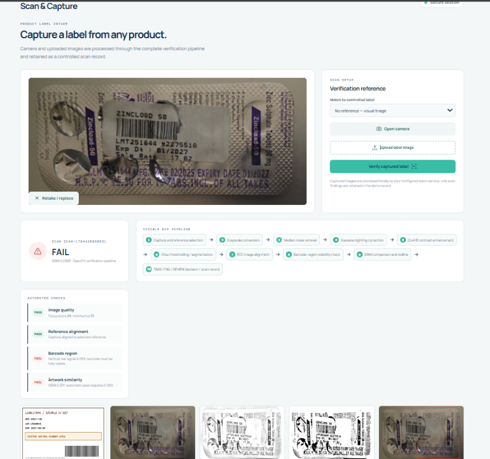
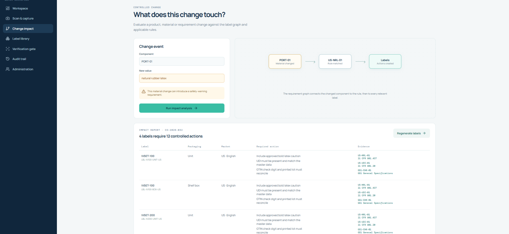
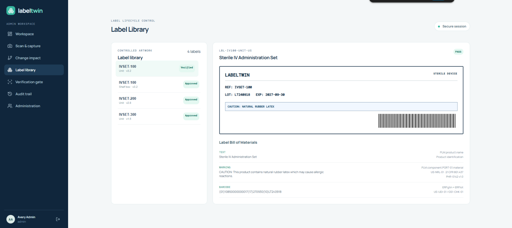
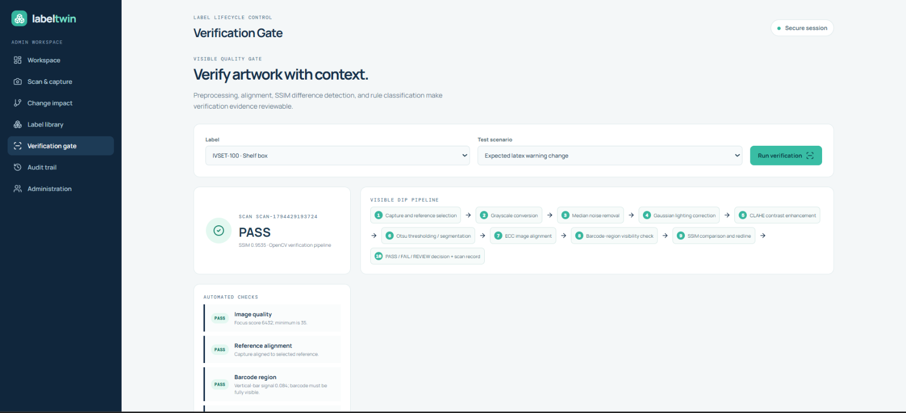
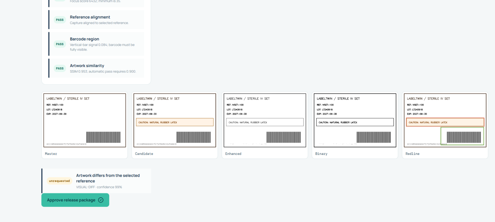
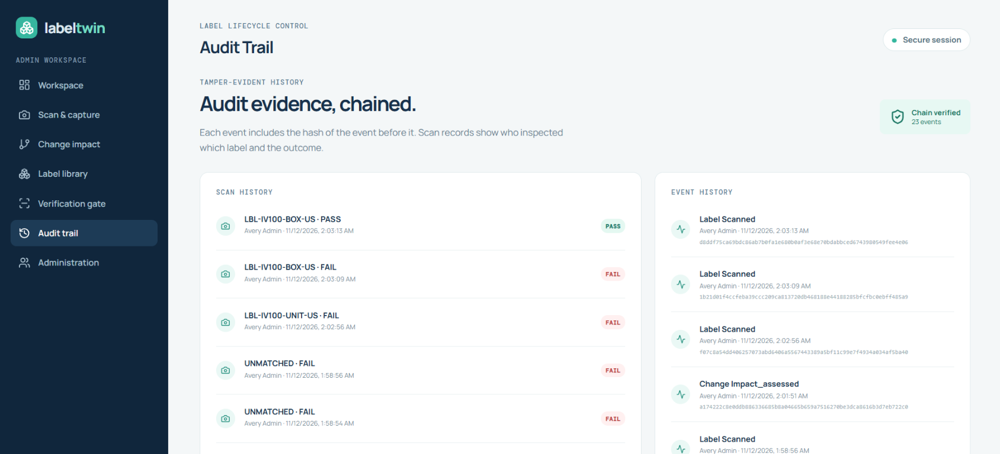
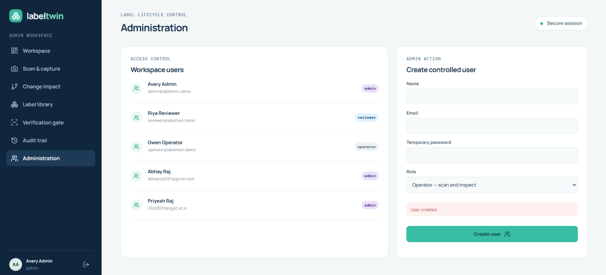

# LabelTwin Quality Console

LabelTwin is a label lifecycle and verification console for controlled product
artwork. It connects product changes to regulatory rules, affected labels,
camera or upload evidence, automated visual checks, release decisions, and a
tamper-evident audit trail.

## What the project demonstrates

- Role-based access for **admin**, **reviewer**, and **operator** users.
- Controlled label library with label versions, markets, packaging formats,
  source fields, and bill-of-material traceability.
- Change-impact analysis for product or material changes.
- Camera and uploaded-image capture.
- OpenCV verification with quality, alignment, barcode-region, and SSIM checks.
- PASS, FAIL, and UNSURE decisions with evidence images and findings.
- Release approval guarded by a passing verification gate.
- Hash-chained audit events and audit-chain verification.
- MongoDB persistence when available, with an in-memory demo fallback.

## Architecture

```text
                         +----------------------+
                         | React + Vite frontend|
                         |       :5173          |
                         +----------+-----------+
                                    |
                                    v
                         +----------------------+
                         | Express API          |
                         | auth, labels, scans, |
                         | changes, releases    |
                         |       :5000          |
                         +-----+-----------+----+
                               |           |
                               v           v
                    +----------------+  +----------------+
                    | FastAPI/OpenCV |  | MongoDB        |
                    | vision service |  | optional       |
                    |      :8000     |  |      :27017    |
                    +----------------+  +----------------+
```

### Repository layout

```text
frontend/                 React + Vite console
backend/api/              Node.js + Express API
backend/api/src/data/     Demo labels, rules, phrases, and seed change
backend/api/src/services/ Impact analysis and audit-chain services
backend/vision/           FastAPI + OpenCV service
backend/vision/app/       Vision API implementation
docker-compose.yml        MongoDB, API, vision, and frontend services
docs/images/              Product screenshots used in this README
```

## Screenshots

### Scan and capture

The capture workflow accepts a camera image or uploaded label image, lets the
operator choose a controlled reference, and displays the scan result.



### Change impact

The change-impact view maps a changed component to a matched rule and the
controlled labels requiring action. Each action includes rule and citation
evidence.



### Label library

The label library displays controlled artwork and explains why each label
element exists, including source systems, rules, phrases, and change orders.



### Verification gate

The verification gate supports deterministic demo scenarios such as barcode
mismatch, expected latex-warning change, and clean regenerated artwork.



The evidence view exposes the master image, candidate image, enhanced image,
binary segmentation, redline, automated checks, and findings.



### Audit trail and administration

The audit trail shows scan history, event history, hash-chain status, actor,
timestamp, and event hashes.



Administrators can view workspace users and create controlled users with
explicit roles.



## Run locally on Windows

Open PowerShell and run these commands from the project directory:

```powershell
cd C:\Users\91907\OneDrive\Desktop\LabelTwin
Copy-Item .env.example .env
npm run install:all
npm run dev
```

Then open **http://localhost:5173**.

`npm run dev` starts all three application processes:

| Service | Address | Purpose |
|---|---|---|
| Frontend | `http://localhost:5173` | React console |
| API | `http://localhost:5000` | Authentication and application API |
| Vision | `http://localhost:8000` | Image verification API |

Health checks:

```powershell
Invoke-WebRequest http://localhost:5000/api/health
Invoke-WebRequest http://localhost:8000/health
```

The API can run without MongoDB by using temporary demo-memory storage. Start
MongoDB locally or use Docker when persistence is required.

## Demo accounts

```text
Admin:    admin@labeltwin.demo    / Admin@123
Reviewer: reviewer@labeltwin.demo / Review@123
Operator: operator@labeltwin.demo / Operator@123
```

Admin can manage users, reviewers can assess changes and approve releases, and
operators can capture and inspect labels.

## Run with Docker Compose

Docker must be installed and running:

```powershell
cd C:\Users\91907\OneDrive\Desktop\LabelTwin
docker compose up --build
```

Open **http://localhost:5173**. Stop the stack with:

```powershell
docker compose down
```

Docker starts MongoDB, the vision service, the API, and the frontend. Set a
strong `JWT_SECRET` in the API environment before using the stack outside a
demo environment.

## Useful commands

```powershell
npm test             # Run API tests
npm run build        # Build the production frontend
npm run dev          # Start frontend, API, and vision together
npm run dev:vision   # Start only the vision service
npm run dev:api      # Start only the API
npm run dev:frontend # Start only the frontend
```

If `npm run dev` reports that port `5000`, `5173`, or `8000` is already in
use, stop the existing process or start only the missing service. If the UI
shows `UNSURE` with “Vision service unavailable”, run:

```powershell
npm run dev:vision
```

Refresh the browser and run the scan again.

## Vision pipeline

The vision service in `backend/vision/app/main.py` runs this pipeline:

```text
Capture and reference selection
  -> grayscale conversion
  -> median noise removal
  -> Gaussian lighting correction
  -> CLAHE contrast enhancement
  -> Otsu thresholding / segmentation
  -> ECC image alignment
  -> barcode-region visibility check
  -> SSIM comparison and redline
  -> PASS / FAIL / UNSURE decision and scan record
```

The barcode check currently confirms that a barcode-like region is visible and
clear enough for review. It does not decode arbitrary GS1 values from camera
footage. A certified production barcode decoder is required for release-grade
barcode decoding.

## Main API routes

All application routes are under `/api` and require a bearer token after login.

| Method | Route | Purpose |
|---|---|---|
| `GET` | `/api/health` | API and storage health |
| `POST` | `/api/auth/login` | Sign in and receive a JWT |
| `GET` | `/api/dashboard` | Dashboard statistics and audit status |
| `GET` | `/api/labels` | List controlled labels |
| `GET` | `/api/labels/:id` | Label details and traceability |
| `POST` | `/api/changes` | Assess a controlled change |
| `POST` | `/api/changes/:id/regenerate` | Regenerate affected labels |
| `POST` | `/api/scans/capture` | Verify a camera/upload image |
| `POST` | `/api/verify/:id` | Run a selected verification scenario |
| `POST` | `/api/release/:id/approve` | Approve a passing release package |
| `GET` | `/api/audit` | Read audit events |
| `GET` | `/api/audit/verify` | Verify the audit hash chain |

The vision service exposes:

```text
GET  /health
POST /verify
```

## Verification meanings

- **PASS** - required checks passed and the result can proceed to review or
  release approval.
- **FAIL** - a required check failed, such as a barcode-region or artwork
  mismatch.
- **UNSURE** - the image or service is not reliable enough for an automatic
  decision; it must be reviewed.

## Development status

The project has passing API tests, a successful frontend production build, and
Python syntax validation. The vision service also converts NumPy scalar
booleans to JSON-safe values before returning FastAPI responses.

For production use, replace demo credentials, configure a strong JWT secret,
use persistent MongoDB, restrict CORS, add a certified barcode decoder, and
store uploaded evidence in controlled persistent storage.
